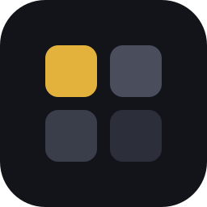
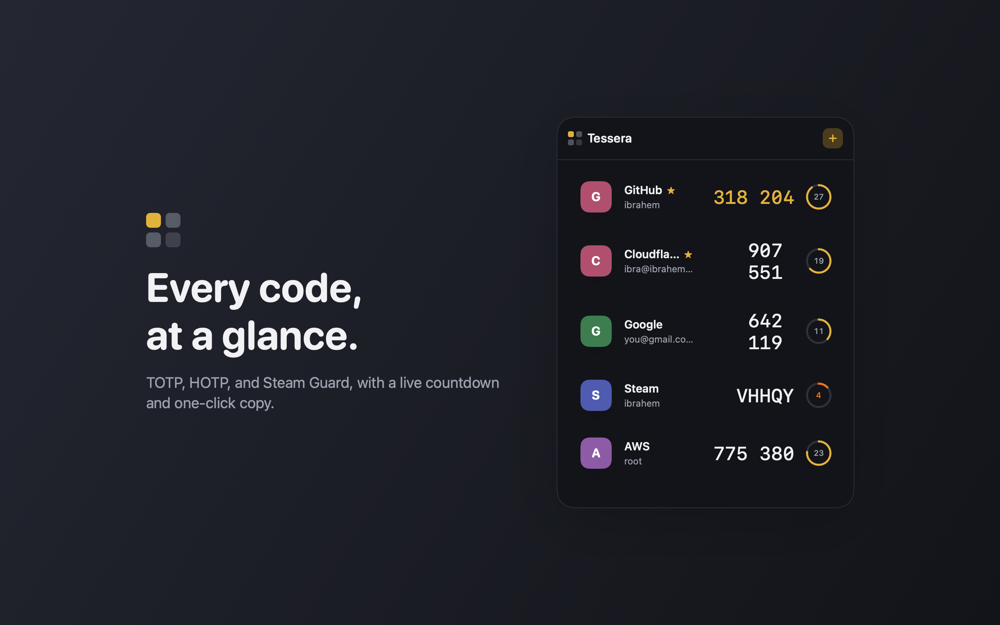

<div align="center">



# Tessera

A TOTP/2FA authenticator for macOS. CLI-first, with a native app.

[](https://github.com/ibrahemid/tessera/actions)
[](LICENSE)
[](https://apps.apple.com/app/tessera-2fa-authenticator/id6788814172)

[**Mac App Store**](https://apps.apple.com/app/tessera-2fa-authenticator/id6788814172) · [**Website**](https://tessera.ibrahemid.com) · [**CLI quick start**](#cli-quick-start)

</div>


Tessera keeps your 2FA codes in an encrypted vault on your Mac, reachable from a native app and a real command line. It ships free what other Mac authenticators paywall (Touch ID, auto-launch), and adds what they lack: a CLI, HOTP, Steam Guard, folders and tags, and one vault that the CLI and the app share. Free, open source, Apache-2.0.

## Features

- TOTP (RFC 6238), HOTP (RFC 4226), Steam Guard
- Import: `otpauth://`, setup keys, Google Authenticator exports (`otpauth-migration://`), QR images (CLI) / on-screen QR (app), and unencrypted exports from Aegis, 2FAS, Raivo, andOTP, FreeOTP+, Stratum, Bitwarden, Proton Authenticator, Ente Auth, Apple Passwords and 1Password
- Export: otpauth URIs, QR images, an encrypted vault copy, or another app's export format (Aegis, 2FAS, Bitwarden Authenticator, Proton Authenticator, andOTP, Apple Passwords CSV, Google Authenticator transfer QR codes)
- Merge two vaults, one way or both ways, when the CLI and the app copies drift apart
- Encrypted vault: random DEK, XChaCha20-Poly1305 payload, unlocked by an argon2id passphrase wrap, a Touch ID (Secure Enclave) wrap, or both
- Search, folders, tags, pinning (app)
- No account, no server, no analytics, no network

## The app

<picture>
  <source media="(prefers-color-scheme: light)" srcset="docs/appstore-assets/01-vault-light.png">
  
</picture>

A native SwiftUI app: live codes with countdown rings, one-click copy, on-screen QR scanning, Touch ID unlock. It opens a CLI-created vault in place (asks for its passphrase once, then unlocks via the Secure Enclave; the CLI keeps working on the same file). App-created vaults are Secure-Enclave-bound: set a recovery passphrase in Settings to add a passphrase wrap (it survives a fingerprint change and lets the CLI open the same vault), or move accounts across with the app's encrypted export.

## Install the CLI

The `tess` CLI builds for macOS, Linux and Windows on arm64 and amd64.

### Homebrew

```sh
brew install ibrahemid/tap/tess
```

Homebrew 6 loads a third-party tap only after `brew trust ibrahemid/tap`; run that first.

### Install script (macOS, Linux)

```sh
curl --proto '=https' --tlsv1.2 -fsSL https://raw.githubusercontent.com/ibrahemid/tessera/main/install.sh | sh
```

It downloads the release archive for your OS and architecture, checks its SHA-256 against `checksums.txt` (with `shasum` or `sha256sum`), and installs `tess` to `/usr/local/bin` when that is writable, else `~/.local/bin`. When `cosign` is on `PATH`, it first verifies the signature on `checksums.txt` and installs nothing if that fails; without `cosign` it prints the command to run by hand. Environment overrides:

- `TESS_VERSION`: install this release instead of the latest, with or without the leading `v`.
- `TESS_INSTALL_DIR`: install into this directory.
- `TESS_BASE_URL`: download the files from this URL instead of the GitHub release.

### Linux packages

Each [release](https://github.com/ibrahemid/tessera/releases) carries a `tessera` package in deb, rpm, apk and Arch (`.pkg.tar.zst`) formats for amd64 and arm64. It installs `/usr/bin/tess`, completions for bash, zsh and fish, and man pages, and suggests `wl-clipboard`, `xclip`, `xsel`, `grim` and `slurp`.

```sh
sudo dpkg -i ./<package>.deb                       # Debian, Ubuntu
sudo dnf install --nogpgcheck ./<package>.rpm      # Fedora
sudo apk add --allow-untrusted ./<package>.apk     # Alpine
sudo pacman -U ./<package>.pkg.tar.zst             # Arch
```

The packages carry no package-manager signature, which is why dnf needs `--nogpgcheck` and apk needs `--allow-untrusted`. Check the file against `checksums.txt` first (below).

### Windows

Download `tess_<version>_windows_amd64.zip` or `tess_<version>_windows_arm64.zip` from the release, unzip it, and put `tess.exe` on your `PATH`. The install script stops on Windows with the same instruction.

### Archives and source

The release also has `tess_<version>_<os>_<arch>.tar.gz` for `darwin` and `linux`: unpack it and put `tess` on your `PATH`. From source, with Go 1.27.4 or later:

```sh
go install github.com/ibrahemid/tessera/go/cmd/tess@latest
```

### Verifying a download

Download `checksums.txt` and `checksums.txt.sigstore.json` from the same release as your file, then:

```sh
shasum -a 256 -c --ignore-missing checksums.txt   # or: sha256sum -c --ignore-missing checksums.txt
cosign verify-blob --bundle checksums.txt.sigstore.json \
  --certificate-identity https://github.com/ibrahemid/tessera/.github/workflows/release.yml@refs/tags/v<version> \
  --certificate-oidc-issuer https://token.actions.githubusercontent.com \
  checksums.txt
```

The release workflow signs `checksums.txt` with keyless cosign and records a GitHub build provenance attestation for every file listed in it, which `gh attestation verify <file> --repo ibrahemid/tessera` checks.

## CLI quick start

```sh
tess vault init                      # create an encrypted vault
tess add "otpauth://totp/ACME:me@x.com?secret=JBSWY3DPEHPK3PXP&issuer=ACME"
tess add --qr ~/Desktop/code.png     # from a QR image
tess add --screen                    # select a QR code on screen (macOS, Linux)
tess import aegis-export.json        # another app's export (see docs/TRANSFER.md)
tess                                 # print current codes (colored, with countdown bars)
tess acme                            # one account's code, copied to the clipboard
tess ac --no-copy                    # by handle (shown by `tess list`), printed only
tess watch                           # live view with countdown bars
tess vault remember                  # store the passphrase in the system secret store
tess completion zsh > ...            # shell completions (bash, fish, powershell, zsh)
```

`tess <query>` is short for `tess code <query>`; a subcommand name always wins over an account handle. The code goes to the clipboard on a terminal, so `tess acme` prints it and copies it. Piped or with `--json`, tess prints the digits and leaves the clipboard alone unless you pass `-c`. `--clear <seconds>` wipes the copy afterwards (default `$TESSERA_CLIP_CLEAR`, else 30 on a terminal; `0` keeps it), and only while the clipboard still holds that code. A code with under four seconds left is held back until the next one, unless you pass `--now` or `--json`.

Completions offer your account handles once the vault opens without a prompt, from `$TESSERA_PASSPHRASE` or the system secret store. Colored output turns off when piped or when `NO_COLOR` is set. JSON output is specified in [`docs/CLI-JSON.md`](docs/CLI-JSON.md).

## Commands

Grouped as in `tess --help`; `tess <command> --help` has the flags and examples.

| Group | Commands |
|-------|----------|
| Codes | `code`, `verify`, `watch` |
| Accounts | `add`, `alias`, `dedupe`, `edit`, `list` (`ls`), `move`, `note`, `order`, `pin`, `rename`, `restore`, `rm`, `show`, `tag`, `trash` (`trash empty`), `unpin` |
| Transfer | `export`, `import`, `merge` |
| Vault | `vault init`, `status`, `backup`, `restore`, `passwd`, `rekey`, `remember`, `forget`, `reset` |
| Other | `completion` (bash, fish, powershell, zsh), `help` |

`tess rm` moves accounts to the Trash; `tess restore` brings them back and `tess trash empty` deletes them for good (`--older-than 30d` limits it to old ones). Pinned accounts list first, then accounts placed with `tess order`, then the rest by issuer and account.

## Watch view

`tess watch` is a full-screen list of live codes with countdown bars. Press `?` in it for the full key list.

| Keys | Action |
|------|--------|
| `↑` `↓`, `j` `k`, `pgup` `pgdn`, `g` `G` | Move |
| `enter`, `c` | Copy the code; under 4 seconds left, copy the next one |
| `n` | Copy the next code; a counter account asks first |
| `/` | Search issuer, account, alias, folder and tags |
| `f`, `t` | Filter by folder, by tag |
| `h` | Hide codes except the selected one |
| `a`, `e` | Add an account from a link or setup key, edit the selected one |
| `p` | Pin or unpin |
| `d`, `u` | Move to the Trash, undo the last move |
| `T` | Open the Trash (`r` restores, `d` deletes after you confirm) |
| `esc` | Clear the search, then the filters, then quit |
| `q`, `ctrl+c` | Quit |

The view locks after 15 minutes without a key press (`--lock-after`, or `$TESSERA_WATCH_LOCK`; `0` never locks). Any key unlocks it with the stored passphrase, or asks for it.

## Environment

| Variable | Effect |
|----------|--------|
| `TESSERA_VAULT` | Vault file path; `--vault` overrides it |
| `TESSERA_PASSPHRASE` | Vault passphrase, so tess does not prompt |
| `TESSERA_NEW_PASSPHRASE` | New passphrase for `tess vault passwd` |
| `TESSERA_MERGE_PASSPHRASE` | Passphrase of the source vault for `tess merge` |
| `TESSERA_BACKUP_DIR` | Absolute path of a folder for a daily backup after every vault change; the 30 newest are kept |
| `TESSERA_CLIP_CLEAR` | Seconds before a copied code is cleared; `0` keeps it |
| `TESSERA_WATCH_LOCK` | Idle time before `tess watch` locks, such as `5m`; `0` never locks |
| `TESSERA_SECRET_BACKEND` | Secret store for `tess vault remember`: `keychain`, `secret-service`, `kernel-keyring` or `credential-manager` |
| `TESSERA_CLIPBOARD` | Clipboard on Linux and other Unix systems: `wayland`, `x11` or `osc52` |
| `XDG_DATA_HOME` | Base folder of the default vault path (below) |
| `NO_COLOR` | Turns off colored output |

tess removes the three passphrase variables from the environment of any program it starts.

## Vault location

`--vault`, else `$TESSERA_VAULT`, else the default:

- macOS: `$XDG_DATA_HOME/tessera/vault.json` when `XDG_DATA_HOME` is set, else `~/.local/share/tessera/vault.json`.
- Linux and other Unix systems: the same, with `XDG_DATA_HOME` used only when it is an absolute path.
- Windows: `%XDG_DATA_HOME%\tessera\vault.json` when that is an absolute path; else `%USERPROFILE%\.local\share\tessera\vault.json` if that file exists; else `%LOCALAPPDATA%\Tessera\vault.json`.

A vault path that is a symbolic link resolves to its target. Next to the vault, tess keeps `vault.json.bak` (the file before the last write) and `vault.json.lock`, all readable by you only. `tess vault status` prints the resolved path.

`tess vault remember` stores the passphrase in the system secret store so tess stops prompting: the login keychain on macOS, the Secret Service on Linux with the kernel keyring as a fallback, and Windows Credential Manager on Windows. It verifies the passphrase against the vault first; `tess vault forget` removes it.

## Launchers

- [Raycast](integrations/raycast/README.md): extension that searches accounts and copies or pastes codes through `tess`.
- [Alfred](integrations/alfred/README.md): workflow with the same actions under the `2fa` keyword.

## Security model

- Secrets are stored as raw bytes inside an encrypted vault; base32 only appears at otpauth boundaries.
- Vault: a random 256-bit DEK encrypts the account payload (XChaCha20-Poly1305, 24-byte nonces). The DEK is wrapped per unlock method: an argon2id-derived passphrase key, a biometric-gated Secure Enclave key, or both. Adding/removing an unlock method re-wraps the DEK without re-encrypting the payload.
- Two independent implementations (Go, Swift) share one documented format and a byte-exact interop vector suite, with cross-decrypt and negative (tamper / wrong-passphrase / base64url) tests.
- No analytics, no servers. See [SECURITY.md](SECURITY.md) for reporting.

The exact rules live in [`spec/vault-format.md`](spec/vault-format.md) and [`spec/otpauth.md`](spec/otpauth.md).

## Documentation

- [`docs/TRANSFER.md`](docs/TRANSFER.md): moving accounts between Tessera and other apps, and merging vaults.
- [`docs/CLI-JSON.md`](docs/CLI-JSON.md): the `--json` output of each command.
- [`docs/BUILD.md`](docs/BUILD.md): toolchains, the gate script, tests and releases.
- [`spec/vault-format.md`](spec/vault-format.md) and [`spec/otpauth.md`](spec/otpauth.md): the vault format and the OTP rules both implementations follow.

## Repository layout

| Path | What |
|------|------|
| `spec/` | Source of truth: vault format, otpauth/OTP rules, shared interop test vectors |
| `go/` | The `tess` CLI and its core |
| `swift/` | `TesseraCore` library + the SwiftUI app |
| `integrations/` | Raycast extension and Alfred workflow |
| `site/` | The website |
| `scripts/` | `gate.sh` (every check) and `release-check.sh` |
| `test/` | Install script test and the Linux container suites |
| `install.sh` | The install script |

## License

Apache-2.0.
